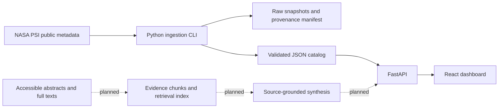

# Kiến trúc

## Ranh giới trách nhiệm

- **Web**: nhập truy vấn, trình bày danh mục và nguồn; giữ trạng thái tìm kiếm/phân trang.
- **API**: công bố hợp đồng OpenAPI, kiểm tra tham số và trả dữ liệu đã chuẩn hóa.
- **Ingestion**: thu thập metadata, lưu nguồn gốc và tạo catalog; chạy tách biệt với request của người dùng.
- **Kho tri thức**: giai đoạn tiếp theo sẽ lưu nội dung tài liệu và truy hồi bằng chứng.

API hiện dùng adapter đọc JSON. Khi dữ liệu cần truy vấn phức tạp hoặc nhiều người cùng cập nhật, thay adapter này bằng cơ sở dữ liệu quan hệ, giữ nguyên các thực thể và hợp đồng HTTP. Chưa chọn hạ tầng cloud hay provider AI.

## Endpoint hiện có

| Endpoint | Chức năng |
| --- | --- |
| `GET /health` | Kiểm tra tiến trình API |
| `GET /api/v1/summary` | Số hồ sơ, công bố, liên kết và trạng thái catalog |
| `GET /api/v1/investigations` | Lọc `q`, `family`, `limit`, `offset` |
| `GET /api/v1/investigations/{id}` | Hồ sơ và các công bố liên quan |
| `GET /api/v1/publications` | Lọc `q`, `investigation_id`, `limit`, `offset` |
| `GET /docs` | Swagger UI |
| `GET /openapi.json` | Hợp đồng API cho frontend và công cụ khác |

Danh mục chưa tồn tại được trả thành kho trống. Catalog hỏng trả HTTP 503; không biến lỗi dữ liệu thành kết quả 0 bản ghi. Các endpoint danh sách trả `{items, total, offset, limit}`.

Tìm kiếm hiện là đối chiếu văn bản metadata. Tìm kiếm ngữ nghĩa, xếp hạng theo tình huống và sinh insight là các phần chưa triển khai.
