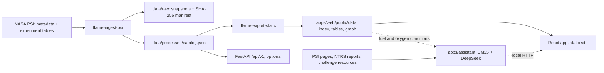

# Architecture

## Parts and responsibilities

| Part | Path | Responsibility |
| --- | --- | --- |
| Ingestion | `apps/api/src/flame_api/ingestion/` | Fetch PSI metadata and experiment tables, keep raw snapshots with hashes, extract fuel and oxygen per table (`tables.py`), validate the catalog |
| Static export | `apps/api/src/flame_api/export_static.py` | Write `index.json`, one tables file per investigation, and `graph.json` for the web app |
| Knowledge graph | `apps/api/src/flame_api/graph.py`, `verify_graph.py` | Build the graph with evidence on every edge; reconcile it with the raw records ([details](knowledge-graph.md)) |
| Web | `apps/web` | Overview, knowledge map, experiment library, investigation pages, research assistant page. Reads static JSON and filters in the browser, so the deployed site needs no server |
| API | `apps/api/src/flame_api/routes/` | The same catalog over HTTP with filters and facets, for tools that need a backend |
| Research assistant | `apps/assistant` | Question answering over NASA sources with citation guardrails. Runs on the team's machine (`uvicorn assistant.api:app --port 8003`); the web page calls it when it is running and shows saved answers otherwise |

## Why static

The judges open a link; nothing should depend on a server staying up. The catalog is small (24 investigations, about 300 KB of JSON plus about 470 KB of graph), so the browser filters it directly. The graph library is loaded only when the knowledge map is opened.

The assistant needs an API key, which must not reach the browser, so it stays a local service.

## API endpoints

| Endpoint | Purpose |
| --- | --- |
| `GET /health` | Process check |
| `GET /api/v1/summary` | Counts and catalog state |
| `GET /api/v1/investigations` | Filters: `q`, `family`, `platform`, `topic`, `hardware`, `fuel`, `o2_min`, `o2_max`, `o2_ambient_only`, `has_table`, `limit`, `offset` |
| `GET /api/v1/investigations/{id}` | Record with publications, experiment tables and related investigations |
| `GET /api/v1/facets` | Filter options with counts |
| `GET /api/v1/publications` | Publications, optionally for one investigation |

OpenAPI docs: `/docs` when the API runs.
