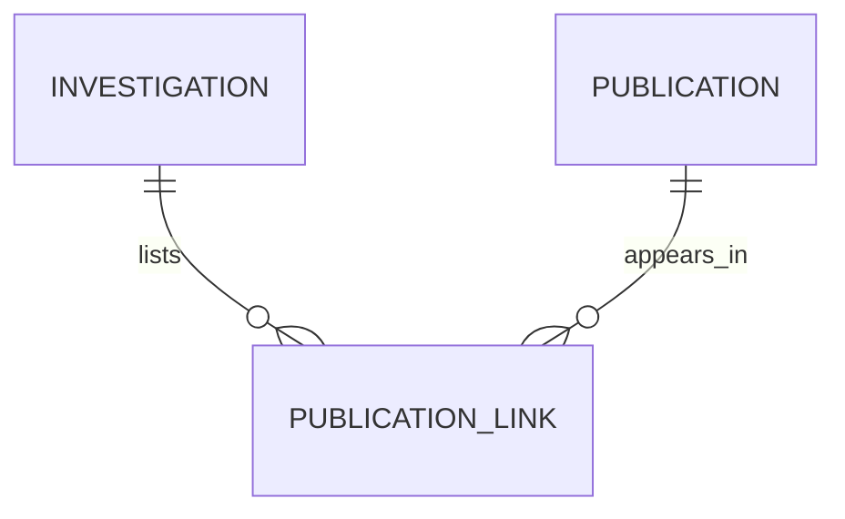

# Mô hình dữ liệu

## Các thực thể đã triển khai

| Thực thể | Ý nghĩa | Định danh |
| --- | --- | --- |
| `Investigation` | Hồ sơ nghiên cứu: mục tiêu, phương pháp, thiết bị, nguồn | Mã PSI |
| `Publication` | Một bản ghi tài liệu liên quan | Hash của DOI chuẩn hóa; nếu thiếu DOI, hash định danh mục nguồn |
| `PublicationLink` | Một mục Publications được liệt kê trong hồ sơ | Cặp investigation ID và số thứ tự mục nguồn |
| `Catalog` | Snapshot đã chuẩn hóa, có phiên bản schema | `schema_version`, `retrieved_at` |

`PublicationLink.relation = listed_in_psi` không xác nhận quan hệ tài trợ, tác giả hay nguồn dữ liệu trực tiếp. Một publication không tự động kế thừa mọi điều kiện thí nghiệm trong investigation liên quan.

## Quy tắc dữ liệu

1. DOI dữ liệu của investigation và DOI của publication là hai trường riêng.
2. DOI được chuẩn hóa tiền tố và chữ hoa/thường. Cùng DOI có thể gộp bản ghi; mọi mục liên kết và tiêu đề tại nguồn vẫn giữ nguyên.
3. Thiếu DOI: giữ từng mục nguồn riêng. Không tự gộp bằng tiêu đề hoặc xóa năm để so khớp, vì có thể là các phiên bản hội nghị/tạp chí khác nhau.
4. Cùng tiêu đề nhưng DOI khác: giữ riêng.
5. `availability` phân biệt `metadata_only`, `abstract`, `full_text`. Import metadata chỉ tạo trạng thái `metadata_only`.
6. `family` từ acronym là phân loại ban đầu có căn cứ ghi riêng. Nghiên cứu mặt đất không có acronym cần được đối chiếu thủ công; các `related_ids` vẫn giữ để xem quan hệ dữ liệu.
7. Thống kê được tính từ catalog. Số bản ghi phụ thuộc snapshot và chính sách đối chiếu, không cố định theo kết quả khảo sát sơ bộ trước đó.

## Các thực thể dự kiến bổ sung

- `ExperimentalRun`: investigation, test ID, loại thí nghiệm/mô phỏng, vật liệu, hình học, kích thước, trọng lực và điều kiện.
- `Measurement`: run ID, đại lượng, giá trị, đơn vị, sai số, phương pháp đo và vị trí nguồn.
- `Document`: publication ID, phiên bản tài liệu, nguồn và mức nội dung truy cập được.
- `EvidenceChunk`: nội dung, document ID, trang/bảng/đoạn hoặc dòng dữ liệu.
- `Insight`: nhận định, các evidence ID hỗ trợ, điều kiện áp dụng, giới hạn và nhãn phân biệt kết luận tác giả với tổng hợp của SI.

Khi thêm số đo, phân biệt O2 trong buồng với O2 ở dòng cấp đầu đốt; trọng lực nơi đo với trọng lực nơi muốn áp dụng; giá trị thiếu với số 0. Giữ đơn vị gốc cùng giá trị đã chuẩn hóa.
