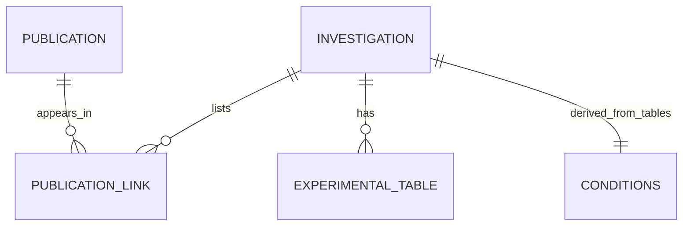

# Data model

Pydantic models in `apps/api/src/flame_api/models.py`; TypeScript mirrors in `apps/web/src/types.ts`.

## Entities

| Entity | Meaning | Identifier |
| --- | --- | --- |
| `Investigation` | A PSI record: objectives, approach, hardware, platform, topic, dates, conditions, source link | PSI accession (`PSI-25`) |
| `Conditions` | Derived from the investigation's experiment tables: fuels with category and row counts, oxygen observations, run count | Part of the investigation |
| `O2Observation` | Oxygen range from one table, in percent by volume, with basis (`ambient` chamber or `oxidizer_stream` burner-fed), source column and distinct recorded levels | Part of conditions |
| `ExperimentalTable` | A PSI experiment table: columns, rows, the fuel and oxygen columns used | File name |
| `Publication` | One publication record | Hash of the normalized DOI; without a DOI, hash of the source entry |
| `PublicationLink` | One entry in an investigation's publication list | Investigation ID + entry number |
| `Catalog` | A validated snapshot, schema version 2 | `retrieved_at` |

`PublicationLink.relation = listed_in_psi` says only that PSI lists the publication on the record; it does not claim authorship, funding or that the publication used that data. A publication does not inherit the investigation's test conditions.

The knowledge graph built from these entities is described in [knowledge-graph.md](knowledge-graph.md).

## Rules

1. The dataset DOI of an investigation and the DOI of a publication are separate fields.
2. DOIs are normalized (prefix and case). Records with the same DOI are merged; every source entry and title is kept.
3. Without a DOI, each source entry stays separate. Titles are never used to merge, because a conference and a journal version can share one.
4. Fuel names come from a dictionary match on the table's fuel column (`ingestion/tables.py`); a cell that does not name a material is not guessed.
5. Oxygen is normalized to percent by volume from fractions, percents, ranges, lists and text. Chamber oxygen and burner-fed oxygen are never mixed. A table without an oxygen column means "not recorded", not zero.
6. Program (`family`) comes from the PSI acronym. Ground studies without an acronym are not assigned to a program by keyword.
7. Statistics are computed from the catalog; they depend on the snapshot.

## Not modelled yet

- Per-run measurements beyond fuel and oxygen (spread rate, burn time, pressure, airflow), with units and methods.
- Full-text documents and evidence chunks with page locations in the web catalog (the assistant has its own corpus).
- Findings: a stated conclusion linked to its evidence and conditions.
