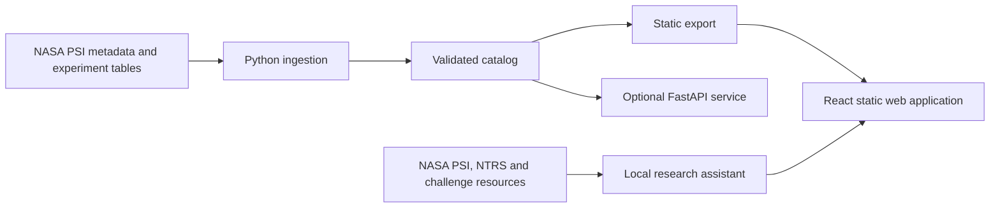

# Flame Atlas — System Summary

## Purpose

Flame Atlas is a NASA Space Apps Challenge 2026 project for exploring evidence from NASA Physical Sciences Informatics (PSI) microgravity-combustion investigations. It helps researchers and fire-safety engineers answer what NASA has tested, under which conditions, and where the available evidence stops.

## Architecture

The primary user experience is a static React application. It reads exported JSON in the browser, allowing the core catalog to be deployed to GitHub Pages without a continuously running backend. The API, research assistant, and forecasting service are optional local services.

## Main components

| Component | Location | Role |
| --- | --- | --- |
| Web application | `apps/web` | React, TypeScript and Vite user interface; reads static JSON exports. |
| API and ingestion | `apps/api` | FastAPI catalog endpoints, PSI ingestion, normalization, graph verification and static export. |
| Research assistant | `apps/assistant` | Source-grounded question answering with BM25/hybrid retrieval, citations and optional DeepSeek generation. |
| Forecast models | `ml_modelling` | Serialized source-specific burn-time models and the training notebook. |
| Static catalog | `apps/web/public/data` | Committed catalog, investigation tables, knowledge graph, FLEX summaries and histories used by the web app. |
| Documentation and data tools | `docs`, `data`, `pipelines` | Product/architecture notes, local data areas and supporting scripts. |

## Available web modules

| Module | Status | Summary |
| --- | --- | --- |
| Overview | Built | Oxygen-atmosphere presets, experiment coverage, fuels/materials, evidence gaps and timeline. |
| Knowledge map | Built | Evidence-backed graph of programs, investigations, publications, datasets, concepts and fuels. |
| 3D flame chamber | Built | Interactive visual representation of flame behavior and microgravity conditions. |
| Experiment library | Built | Search and filter investigations by fuel, oxygen, platform, hardware, topic and program; inspect source tables. |
| Burn time forecaster | Built | Local prediction interface for PSI-159 and PSI-69 source-specific burn-time models. |
| Material comparison | Not built | Intended comparison of selected investigations or materials. |
| Research assistant | Built | NASA-source-grounded answers with citations; saved samples are available if the local service is offline. |
| Habitat check | Not built | Intended cabin-atmosphere/material evidence check. |
| Data analytics | Built | Reviewed FLEX, BASS-II, CFI-G and SAFFIRE-II table exploration, filtering, charting, row comparison and CSV export. |

## Catalog and evidence

The committed static catalog snapshot contains 24 PSI investigations, 303 publications and 352 investigation-publication links. The web export contains 20 investigation-table JSON files and 269 FLEX history files.

Fuel and oxygen conditions are extracted from PSI experiment tables through explicit table specifications. The application keeps chamber oxygen separate from burner/oxidizer-stream oxygen and records absent values as missing rather than inferring them. Every knowledge-graph edge is intended to retain a supporting evidence path.

## Search engine and experiment discovery

The **Experiment library** is the catalog search engine. It operates entirely on the static export in the browser, so filtering remains available on GitHub Pages without the API.

- Search covers investigation IDs, titles, objectives, approaches, fuels, programs and linked-publication titles, authors and DOIs.
- A text query is an AND search: every entered word must occur in an investigation or in one of its linked publications. If a publication supplied the match, the result identifies that publication.
- Faceted filters can be combined for fuel/material, oxygen range, ambient-only oxygen, platform, hardware, topic, program family and availability of an experiment table. Values within one facet are OR-ed; different facets are AND-ed.
- Oxygen filtering is evidence-aware: it matches recorded ranges, can restrict to chamber/ambient oxygen, and does not fabricate values where a table lacks oxygen data.
- State is encoded in the URL, which makes filtered searches and individual investigation pages shareable.

This search engine is deliberately a catalog/discovery tool, not a semantic full-text search of every publication PDF. Full-text retrieval belongs to the research assistant.

## Research assistant (chatbot)

The research assistant is a source-grounded RAG system for questions about microgravity combustion. It is the primary conversational interface of the project.

### Sources and retrieval

Its corpus combines NASA PSI records, NTRS reports and challenge resources. The local assistant loads source chunks and supports:

- **BM25 keyword retrieval** with normalization, conservative stemming, domain synonym expansion and NASA/combustion terminology.
- **Hybrid retrieval**, when local embeddings are available: it combines BM25 with semantic vector similarity, applies relevance thresholds, and rejects weak lexical matches whose semantic score is too low.
- Retrieval over investigations and documents, enabling answers to connect a NASA record, an experiment condition and a cited report passage.
- A practical offline fallback. If the assistant service is unavailable, the web app uses saved example answers or a client-side grounded pipeline over the static catalog rather than pretending that an LLM answered.

### Answering, verification and user experience

The assistant UI supports multi-turn questions, streamed status/output, examples, source navigation and a panel showing the exact cited passage. It offers an offline/free mode and an optional DeepSeek mode. Before a paid call, the UI can preview prompt/context size and estimated cost, then asks for confirmation.

Generated answers must use source tags. Post-processing checks citations against the retrieved sources, removes unsupported or fabricated labels, and can refuse to answer when the evidence is insufficient. Responses retain citations, warnings, retrieval/tool-call details, optional charts and a trace identifier. The system records trace and cost information locally for debugging and evaluation.

The assistant is served locally at port 8003 by default. Its DeepSeek integration needs `DEEPSEEK_API_KEY`; without a key, retrieval and offline evidence display still work. API keys never belong in the static web build.

## Data analytics

The **Data analytics** module is the evidence-inspection workspace for reviewed experimental measurements. Unlike the catalog overview, it works at source-row level and preserves the original cells and provenance.

The current MVP includes five reviewed tables across four investigations:

| Investigation/table | Reviewed content |
| --- | --- |
| FLEX | 274 source rows, including per-test FLEX summaries and selectable history files. |
| BASS-II | 129 rows of initial/final gas readings. |
| CFI-G normal flames | 179 rows; oxygen basis is kept separate from inverse-flame data. |
| CFI-G inverse flames | 154 rows; zero burn times are retained as ignition failures rather than deleted. |
| SAFFIRE-II | 9 source-text samples, kept distinct from 2 flow references and 4 source notes. |

Users can filter by the conditions that the selected source actually records, including material, oxygen, pressure, test end or hot-ignition status. They can choose measured X/Y quantities for plots, inspect point groups and original cells, select up to three rows for comparison, and export a CSV containing units, filters, quality flags, provenance and raw values.

The module makes uncertainty and schema limitations explicit. Missing, qualified and physically invalid values remain distinct; CFI-G oxygen bases are not mixed; approximate pressure stays labelled; ambiguous SAFFIRE-II geometry/material fields remain ambiguous; and qualitative outcomes are not silently converted into numeric measurements. This prevents visually convenient but scientifically invalid comparisons.

## Forecasting

The forecasting API is exposed at `POST /api/v1/forecast` and loads a local `.joblib` artifact. It does not calculate predictions in the browser.

- **PSI-159:** XGBoost model trained on 161 natural-extinction rows. Its output is an estimated duration conditional on natural extinction, not an operator-stop or safety estimate.
- **PSI-69:** Extra Trees model trained on 268 rows. Its output represents observed duration under the historical protocol.

Both models return a grouped out-of-fold residual prediction interval. This is a supporting, local-only module; it is source-specific, has documented data limits, and must not be interpreted as causal or operational fire-safety prediction.

## Running and deployment

- `npm run dev:web` runs the web application locally.
- `npm run build` produces the static web build.
- `uvicorn flame_api.main:app --port 8000` starts the optional catalog and forecast API.
- `uvicorn assistant.api:app --port 8003` starts the optional research-assistant service.

GitHub Actions builds and deploys the static web app to GitHub Pages on pushes to `main`. Because GitHub Pages is static, the research assistant and burn-time forecaster require a separately running local/API service to produce live results.

## Current implementation notes

- Web tests currently pass (`39/39`).
- At the time this document was written, TypeScript type-checking is blocked by unresolved `three` and `@tailwindcss/vite` modules in the local dependency installation, plus a missing `forecast` entry in `MODULE_SHORT` in `apps/web/src/components/SideNav.tsx`.
- Some older documentation is not fully aligned with the current menu: the application now has nine modules, including the forecaster, and marks the 3D chamber and data analytics modules as built.
